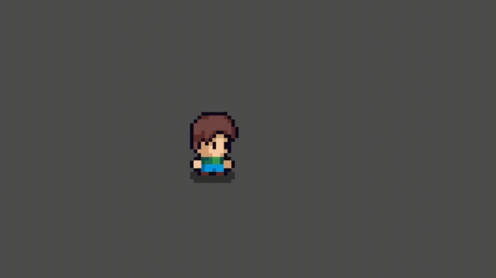
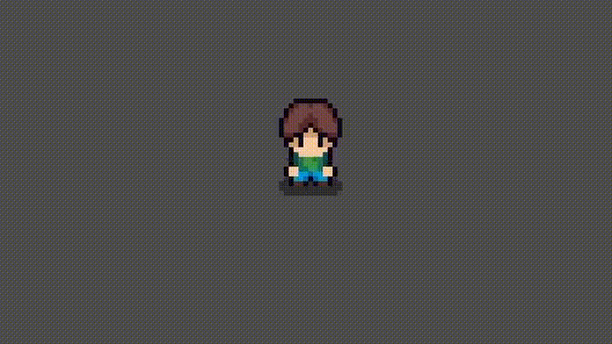
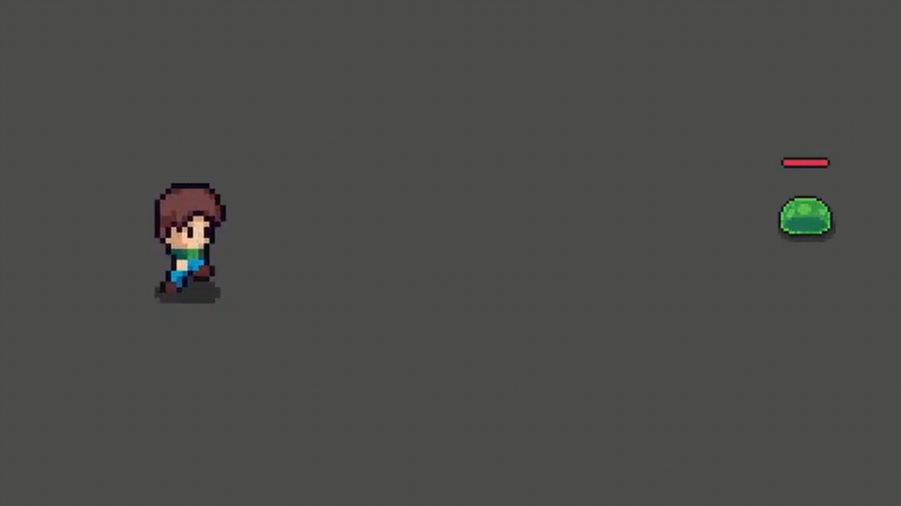

# Game2D

A 2D action RPG prototype built in **Godot (GDScript)**, following the [@CodeWithRuss](https://www.youtube.com/@CodingWithRuss) tutorial.

- **Tutorial Playlist:** [YouTube Playlist](https://youtube.com/playlist?list=PLjcN1EyupaQkpgVN3CEeaetxxCrxo4F7v&si=El9C5MOm9SUckzO5)
- **Art Assets:** [Ninja Adventure Asset Pack](https://pixel-boy.itch.io/ninja-adventure-asset-pack)

---

## Features & Mechanics

### 1. Player Movement & Running Animation
- **Input Map:** Configured movement actions (`left`, `right`, `up`, `down`) for arrow keys and **WASD**.
- **Horizontal Flipping:** Left and right movement share the same base animation (`*_right`) and flip horizontally (`flip_h`) when facing left, avoiding duplicate sprite sheets


**Running Down**  


**Running Left & Right**  


That's why the frame numbers appear reversed on the flipped view. Here is the direction and animation flipping logic:


**Running Up**  


- 

### 2. Attacking Animation & Hitbox
- Added the `attack` input action.
- Temporarily locks movement (`velocity = Vector2.ZERO`), enables `Hitbox` monitoring during the attack, plays `SwingSword` audio, and repositions the hitbox according to `last_direction`.


- 

### 3. Dealing Damage & Enemy Behavior
- Attacks hitting enemies (`Slime*`) deal `20` damage (`strength`) and pass the attacker's position.
- Enemies (`100` HP) chase the `Player` within their `Sight` area, update their `HealthBar`, apply a `0.5s` cubic ease-out knockback tween on hit, play damage/death sound effects, and disable collisions when defeated.

- 

---

## Key Scripts

### Player (`CharacterBody2D`)

```gdscript
extends CharacterBody2D

const SPEED = 300.0

var last_direction: Vector2 = Vector2.RIGHT
var is_attacking: bool = false
var hitbox_offset: Vector2
var strength: int = 20

@onready var animated_sprite_2d: AnimatedSprite2D = $AnimatedSprite2D
@onready var swing_sword: AudioStreamPlayer2D = $SwingSword
@onready var hitbox: Area2D = $Hitbox

func _ready() -> void:
	# Initialise hitbox offset
	hitbox_offset = hitbox.position

func _physics_process(_delta: float) -> void:
	# Disable hitbox until an attack is triggered
	hitbox.monitoring = false

	if Input.is_action_just_pressed("attack") and not is_attacking:
		attack()

	# Skip movement if attacking
	if is_attacking:
		velocity = Vector2.ZERO
		return

	process_movement()
	process_animation()
	move_and_slide()

# -----------------------------------------------------------
# MOVEMENT & ANIMATION
# -----------------------------------------------------------
func process_movement() -> void:
	var direction := Input.get_vector("left", "right", "up", "down")

	if direction != Vector2.ZERO:
		velocity = direction * SPEED
		last_direction = direction
		update_hitbox_offset()
	else:
		velocity = Vector2.ZERO

func process_animation() -> void:
	if is_attacking:
		return
	if velocity != Vector2.ZERO:
		play_animation("run", last_direction)
	else:
		play_animation("idle", last_direction)

func play_animation(prefix: String, dir: Vector2) -> void:
	if dir.x != 0:
		animated_sprite_2d.flip_h = dir.x < 0
		animated_sprite_2d.play(prefix + "_right")
	elif dir.y < 0:
		animated_sprite_2d.play(prefix + "_up")
	elif dir.y > 0:
		animated_sprite_2d.play(prefix + "_down")

# -----------------------------------------------------------
# ATTACKING
# -----------------------------------------------------------
func attack() -> void:
	is_attacking = true
	hitbox.monitoring = true
	swing_sword.play()
	play_animation("attack", last_direction)

func _on_animated_sprite_2d_animation_finished() -> void:
	if is_attacking:
		is_attacking = false

# -----------------------------------------------------------
# HITBOX
# -----------------------------------------------------------
func update_hitbox_offset() -> void:
	var x := hitbox_offset.x
	var y := hitbox_offset.y

	match last_direction:
		Vector2.LEFT:
			hitbox.position = Vector2(-x, y)
		Vector2.RIGHT:
			hitbox.position = Vector2(x, y)
		Vector2.UP:
			hitbox.position = Vector2(y, -x)
		Vector2.DOWN:
			hitbox.position = Vector2(y, x)

func _on_hitbox_body_entered(body: Node2D) -> void:
	if is_attacking and body.name.begins_with("Slime"):
		body.take_damage(strength, position)
```[cite: 4]

### Enemy (`CharacterBody2D`)
```gdscript
extends CharacterBody2D

const SPEED: int = 100
const KNOCKBACK_FORCE: int = 100

var is_alive: bool = true
var health: int = 100
var target = null

@onready var animated_sprite_2d: AnimatedSprite2D = $AnimatedSprite2D
@onready var take_damage_sound: AudioStreamPlayer2D = $TakeDamage
@onready var health_bar: Node2D = $HealthBar

func _physics_process(delta: float) -> void:
	if is_alive and target:
		_attack(delta)

func _attack(delta: float) -> void:
	var direction = (target.position - position).normalized()
	position += direction * SPEED * delta
	animated_sprite_2d.play("attack")

func take_damage(damage: int, attacker_position: Vector2) -> void:
	health -= damage
	health_bar.update_health(health)
	if health <= 0:
		_die()
	else:
		take_damage_sound.play()
		# Knockback
		var knockback_direction = (position - attacker_position).normalized()
		var target_position = position + knockback_direction * KNOCKBACK_FORCE
		var tween = create_tween()
		tween.set_ease(Tween.EASE_OUT)
		tween.set_trans(Tween.TRANS_CUBIC)
		tween.tween_property(self, "position", target_position, 0.5)

func _die() -> void:
	is_alive = false
	animated_sprite_2d.play("die")

	take_damage_sound.pitch_scale = 0.5
	take_damage_sound.play()

	# Disable collision
	$CollisionShape2D.set_deferred("disabled", true)
	$Sight/CollisionShape2D.set_deferred("disabled", true)

func _on_sight_body_entered(body: Node2D) -> void:
	if body.name == "Player":
		target = body

func _on_sight_body_exited(body: Node2D) -> void:
	if body.name == "Player" and is_alive:
		target = null
		animated_sprite_2d.play("idle")
```
